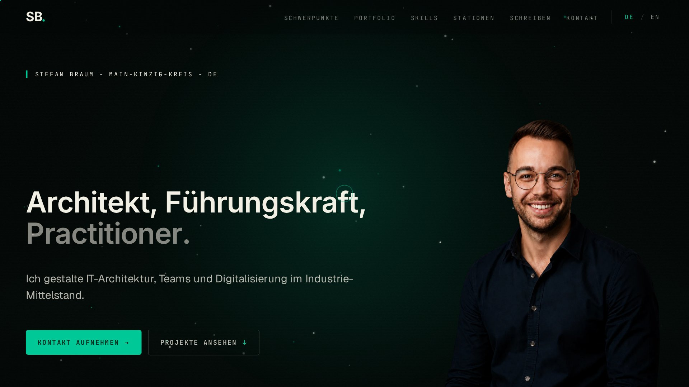

# stefanbraum.de

Personal site source. Astro 5 SSR with the Node adapter, TypeScript strict, Tailwind 4. Forest-green dark theme, two locales (`de` default, `en` under `/en/`), self-hosted blog, dynamic OG-image generation.

**Live:** [stefanbraum.de](https://stefanbraum.de)



## Stack

- [Astro 5](https://astro.build) with `@astrojs/node` (standalone mode)
- TypeScript strict (`noUnusedLocals`, `noUncheckedIndexedAccess`)
- Tailwind 4 via `@tailwindcss/vite`
- Self-hosted variable fonts (Inter, Geist, JetBrains Mono)
- [Satori](https://github.com/vercel/satori) + `@resvg/resvg-js` for dynamic OG images
- GSAP + ScrollTrigger for entry animations
- Three.js (lazy-loaded) for ambient shader and skill sphere
- Astro Content Collections for the blog (Markdown)
- [Biome](https://biomejs.dev) for format + lint
- pnpm

## Local development

```bash
pnpm install
pnpm dev          # http://localhost:5556
pnpm check        # astro check (type errors, accessibility hints)
pnpm build        # production build
pnpm lint         # biome
pnpm format       # biome format --write
pnpm test         # unit tests (node:test, no extra deps)
pnpm test:smoke   # smoke tests against the built server (run after `pnpm build`)
pnpm test:e2e     # browser regression tests (Playwright + axe-core, run after `pnpm build`)
```

CI (`.github/workflows/ci.yml`) runs on every PR: frozen install, Biome, `astro check` + `tsc`, unit tests, production build, smoke tests (core routes, internal links, anchors and chapter order, canonical/hreflang consistency, language switcher, JSON-LD, sitemap, 404s, OG endpoint) and browser tests (layout overflow, pagination, deep links incl. legacy IDs, focus order, axe WCAG 2.1 AA, no-JS, reduced motion).

## Content model

| File | Purpose |
| --- | --- |
| `src/data/profile.ts` | Single source for current role, employer, location, links. Feeds hero, OG image, Person JSON-LD. |
| `src/data/sections.ts` | Order of homepage chapters. Drives rendering, chapter numbers, nav and anchors. |
| `src/data/timeline.ts` | Career stations with `start`/`end` (`null` = present) and `Localized` texts. |
| `src/data/cases.ts` | Portfolio. Optional `en` texts, `featured` + `priority` for highlighting, `status` / `hidePill` overrides. |
| `src/lib/caseStatus.ts` | Status rules: `laufend` = ongoing; a closed range only completes after its end year has passed; explicit `status` always wins. |
| `src/i18n/localized.ts` | `Localized<T>` (`de` required, `en` optional). Missing English falls back to German and is marked with `lang="de"`. |
| `src/i18n/routes.ts` | Which pages exist in both languages. hreflang, canonical and the language switcher are derived from it. |

## Project layout

```
src/
├─ components/      # Astro components (Hero, Cases, Skills, etc.)
├─ content/blog/    # Markdown posts (Astro Content Collection)
├─ data/            # Typed data (profile, sections, cases, skills, timeline, certifications)
├─ i18n/            # Locale dictionaries (de, en) + helpers
├─ layouts/         # BaseLayout
├─ pages/           # Route handlers
│  ├─ api/og.png.ts # Dynamic OG image endpoint
│  ├─ blog/         # Blog listing + detail
│  ├─ en/           # English mirror routes
│  └─ rss.xml.ts    # RSS feed
├─ lib/             # Pure helpers (case status, env)
├─ scripts/         # Client-side animation
└─ styles/global.css
scripts/smoke.mjs   # Smoke tests against dist/server
tests/              # Unit tests (node:test)
```

## Environment

Copy `.env.example` to `.env` and fill the values you need. All variables are optional except `PUBLIC_SITE_URL` for production.

| Variable           | Purpose                                            |
| ------------------ | -------------------------------------------------- |
| `PUBLIC_SITE_URL`  | Canonical site URL (used in canonical, OG, RSS)    |
| `UMAMI_SCRIPT_URL` | Self-hosted Umami script URL (analytics, optional) |
| `UMAMI_WEBSITE_ID` | Umami site ID (analytics, optional)                |

## Deploy

The included `Dockerfile` produces a non-root, production-ready Node 22 Alpine image. The standalone server reads `HOST` and `PORT` from the environment.

### Container basics

- Internal port: `4321` (Astro Node-Adapter standalone default)
- Bind host: `0.0.0.0` (set via `HOST` env)
- Healthcheck endpoint: `/` returns 200

### docker-compose

```yaml
services:
  web:
    build: .
    environment:
      HOST: 0.0.0.0
      PORT: 4321
      PUBLIC_SITE_URL: https://example.com
    ports:
      - "4321:4321"
```

### Coolify

1. New Resource → Public Repository → repository URL
2. Branch: `main`
3. Build pack: `Dockerfile` (auto-detected)
4. Port mapping: container exposes `4321`
5. Environment variables: at minimum set `PUBLIC_SITE_URL`. Coolify injects `HOST=0.0.0.0` automatically; otherwise add it explicitly
6. Deploy

The container has no persistent state. Logs go to stdout.

## Internationalization

Astro 5 native i18n.

- `de` (default) → `/`
- `en` → `/en/`

UI strings live in `src/i18n/de.ts` and `src/i18n/en.ts`. Blog posts exist in German only (`/blog/<slug>/`); there are intentionally no `/en/blog/<slug>/` routes. English pages link to the German posts with `hreflang="de"`, the language switcher on a German post leads to `/en/blog/`, and hreflang alternates are only emitted for pages that exist in both languages.

To translate a string, edit both dictionaries. The `Translations` type in `de.ts` enforces structural parity.

## License

MIT — see [LICENSE](./LICENSE).

Inhalte (Briefings, Blog-Posts, Texte): © 2026 Stefan Braum, alle Rechte vorbehalten. Die MIT-Lizenz deckt nur Code und Konfiguration ab. Wer den Stack als Template forken will: gerne, aber bitte den Content (Blog-Posts in `src/content/blog/`, Case-Beschreibungen in `src/data/`, Texte in `src/i18n/`) durch eigenen ersetzen.
